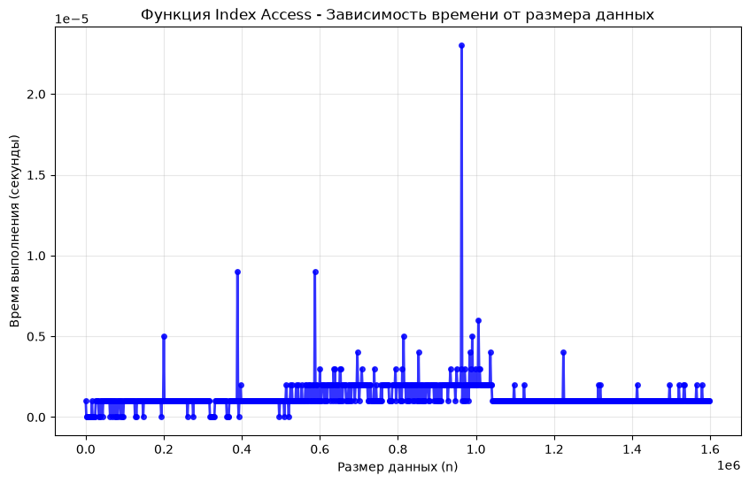
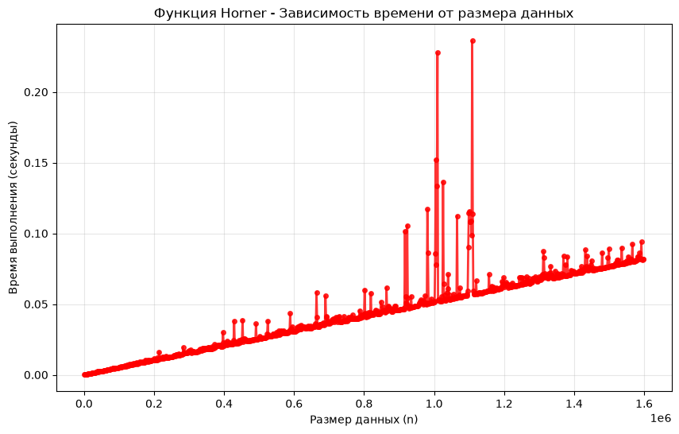
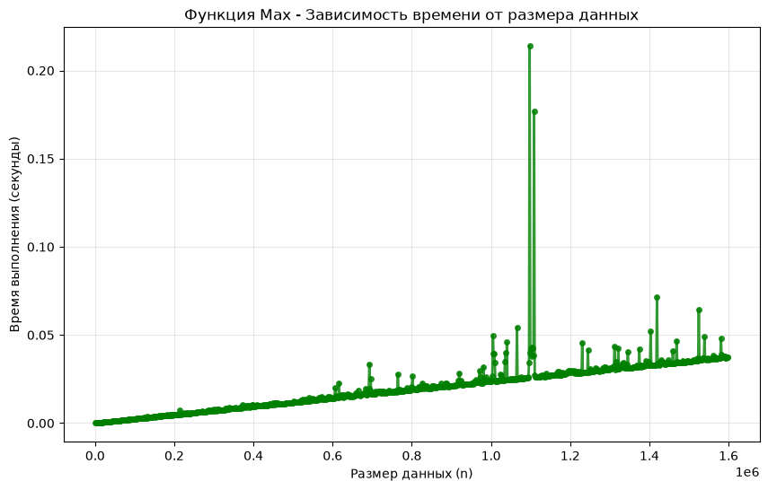
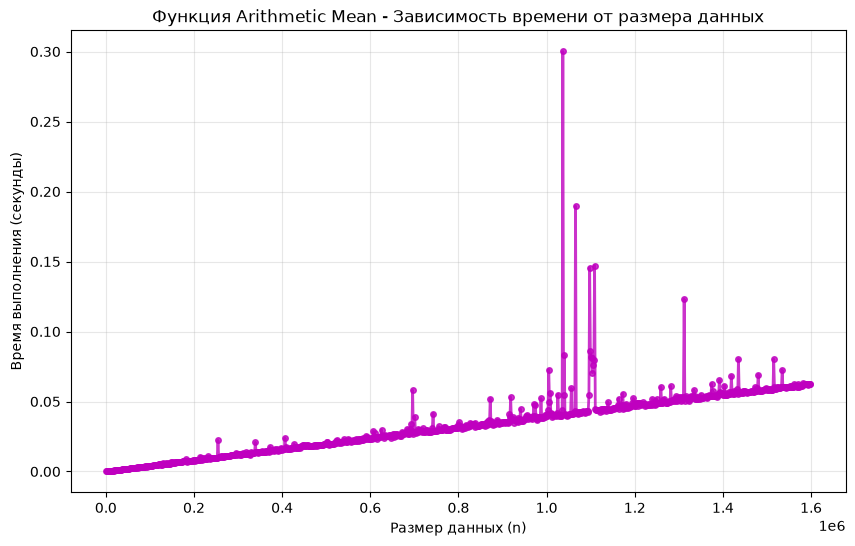
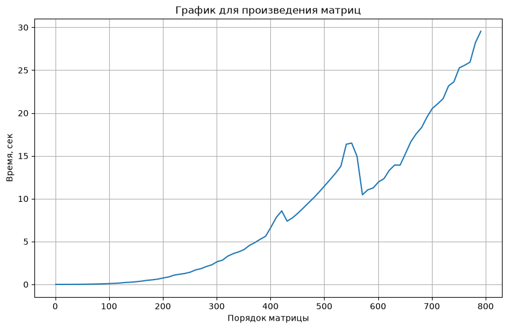

---
jupyter:
  jupytext:
    text_representation:
      extension: .md
      format_name: markdown
      format_version: '1.3'
      jupytext_version: 1.19.5
  kernelspec:
    display_name: .venv
    language: python
    name: python3
---

# **ЛР №1: Эмпирический анализ временной сложности алгоритмов**


---
Работу выполнял Гришин Илья ИУ10-36


## **Цель работы**

Цель работы — эмпирический анализ алгоритмов. Экспериментально исследовать зависимость времени выполнения алгоритмов от размера входных данных и сопоставить экспериментальные результаты с теоретической асимптотической временной сложностью.


## **Формулировка задачи**

Проверсти эмпирический анилиз временной сложности заданных алгоритмов и сопоставить полученные результаты с теоретическими оценками.

Для выполнения задачи нужно для каждого алгоритма при $n$, изменяющемся от $1$ до $10^5 \cdot N$ с шагом $100 \cdot N$, выполнить по 5 замеров времени работы, найти среднее значение и построить график зависимости среднего времени $T(n)$ от $n$. Далее сравнить теоритическую сложность алгоритмов с эмпирически полученной в ходе ЛР, сделать вывод.


---
## **Задача 1**

```python
import random
import matplotlib.pyplot as plt
from usage_time import get_usage_time


# доступ к элементу по индексу: f1(i) = v(i). O(1)
def index_access(v, i):
    return v[i]


# вычисление полинома методом Горнера. O(n)
# horner(v) = v_1 + x(v_2 + x(v_3 + ... + x*v_n))
def horner(v, x):
    result = 0.0
    for c in reversed(v):
        result = result * x + c
    return result


# поиск максимума простым перебором. O(n)
def max_func(v):
    max_val = v[0]
    for value in v[1:]:
        if value > max_val:
            max_val = value
    return max_val


# среднее арифметическое. O(n)
# f7(v) = (1/n) * sum(v_k)
def arithmetic_mean(v):
    total = 0.0
    for value in v:
        total += value
    return total / len(v)


time_index_access = get_usage_time(number=5, ndigits=6)(index_access)
time_horner = get_usage_time(number=5, ndigits=6)(horner)
time_max = get_usage_time(number=5, ndigits=6)(max_func)
time_arithmetic_mean = get_usage_time(number=5, ndigits=6)(arithmetic_mean)

N = 20-4

sizes = list(range(1, 10**5*N, 100*N))

index_access_times = []
horner_times = []
max_times = []
arithmetic_mean_times = []

for n in sizes:
    vector = [random.randint(1, 100) for _ in range(n)]

    index_access_time = time_index_access(vector, n // 2)
    horner_time = time_horner(vector, 2)
    max_time = time_max(vector)
    arithmetic_mean_time = time_arithmetic_mean(vector)

    index_access_times.append(index_access_time)
    horner_times.append(horner_time)
    max_times.append(max_time)
    arithmetic_mean_times.append(arithmetic_mean_time)

plt.figure(figsize=(10, 6))
plt.plot(sizes, index_access_times, 'bo-', linewidth=2, markersize=4, alpha=0.8)
plt.title('Функция Index Access - Зависимость времени от размера данных')
plt.xlabel('Размер данных (n)')
plt.ylabel('Время выполнения (секунды)')
plt.grid(True, alpha=0.3)
plt.show()

plt.figure(figsize=(10, 6))
plt.plot(sizes, horner_times, 'ro-', linewidth=2, markersize=4, alpha=0.8)
plt.title('Функция Horner - Зависимость времени от размера данных')
plt.xlabel('Размер данных (n)')
plt.ylabel('Время выполнения (секунды)')
plt.grid(True, alpha=0.3)
plt.show()

plt.figure(figsize=(10, 6))
plt.plot(sizes, max_times, 'go-', linewidth=2, markersize=4, alpha=0.8)
plt.title('Функция Max - Зависимость времени от размера данных')
plt.xlabel('Размер данных (n)')
plt.ylabel('Время выполнения (секунды)')
plt.grid(True, alpha=0.3)
plt.show()

plt.figure(figsize=(10, 6))
plt.plot(sizes, arithmetic_mean_times, 'mo-', linewidth=2, markersize=4, alpha=0.8)
plt.title('Функция Arithmetic Mean - Зависимость времени от размера данных')
plt.xlabel('Размер данных (n)')
plt.ylabel('Время выполнения (секунды)')
plt.grid(True, alpha=0.3)
plt.show()
```





---
## **Задача 2**

```python
import random
import matplotlib.pyplot as plt
from usage_time import get_usage_time

N = 20 - 4


def matrix_generator(n):
    matrix = []
    for _ in range(n):
        line = [random.randint(1, 100 * N) for _ in range(n)]
        matrix.append(line)
    return matrix

# умножение квадратных матриц a и b. O(n^3)
def matrix_multiply(a, b):
    n = len(a)
    result = [[0.0] * n for _ in range(n)]
    for i in range(n):
        for j in range(n):
            s = 0.0
            for k in range(n):
                s += a[i][k] * b[k][j]
            result[i][j] = s
    return result
"""
O(n)

T(n)
n->+inf
O(T(n))
f(x) = x**2 +600x ... ~ c * x**2
"""


def matrix_proizv(n):
    a = matrix_generator(n)
    b = matrix_generator(n)
    return matrix_multiply(a, b)


def five_iteration_matrix(n):
    time_of_matrix = []
    matrix_time = get_usage_time(ndigits=5)(matrix_proizv)
    for _ in range(5):
        time_of_matrix.append(matrix_time(n))
    average_time_matrix = sum(time_of_matrix) / 5
    return average_time_matrix


items = list(range(1, (10 ** 2 * N) // 2 + 1, 10))
times_matrix = []
for i in items:
    times_matrix.append(five_iteration_matrix(i))

plt.figure(figsize=(10, 6))
plt.plot(items, times_matrix)
plt.title('График для произведения матриц')
plt.xlabel('Порядок матрицы')
plt.ylabel('Время, сек')
plt.grid(True)
plt.show()
```



---
## **Вывод**

В ходе работы проведён эмпирический анализ временной сложности алгоритмов: доступа по индексу (O(1)), метода Горнера (O(n)), поиска максимума (O(n)), среднего арифметического (O(n)) и умножения матриц (O(n**3)). Для каждого алгоритма выполнено по 5 замеров на разных n, результаты усреднены и построены графики зависимости времени от объёма данных. Полученные эмпирические соответствуют теоретическим оценкам. Небольшие отклонения от идеальных кривых объясняются влиянием фоновых процессов ОС и погрешностями измерения, что подтверждает целесообразность усреднения по нескольким запускам. Цель работы достигнута: экспериментальные данные подтвердили теоретические асимптотические оценки сложности рассмотренных алгоритмов.

