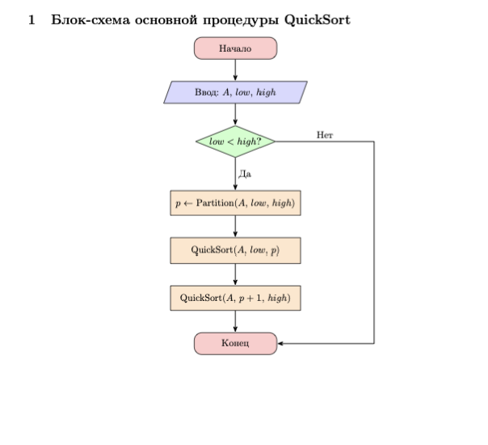
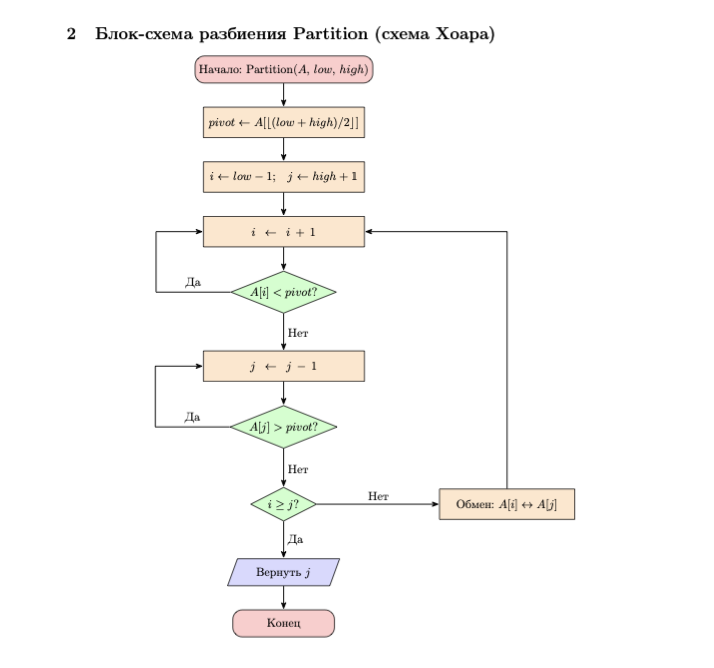
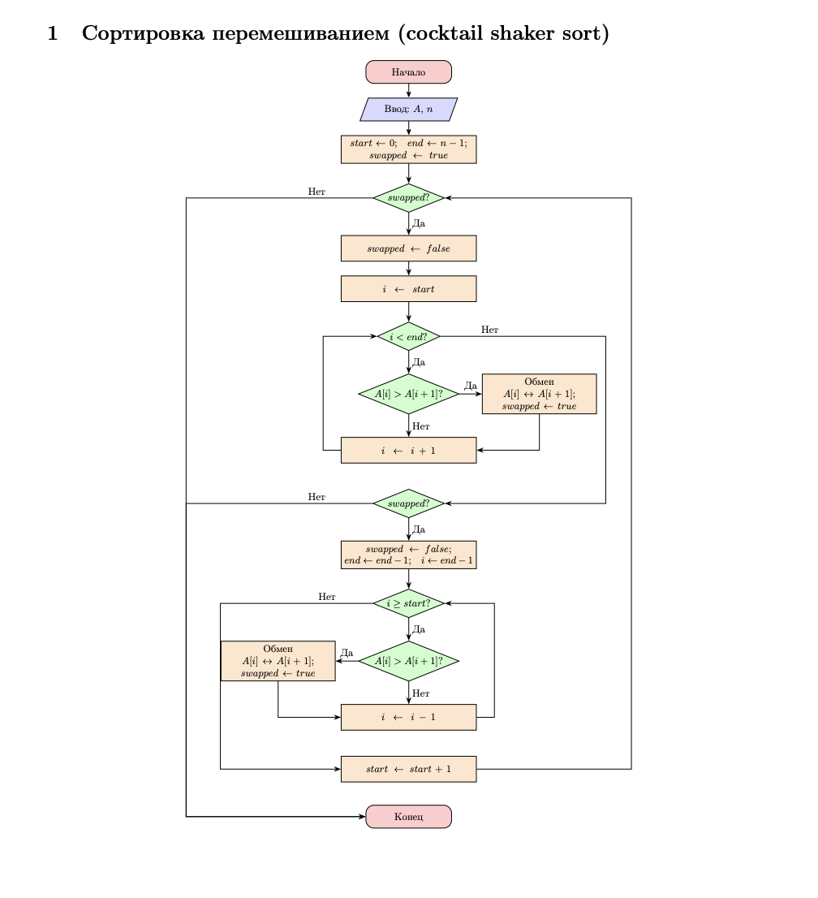
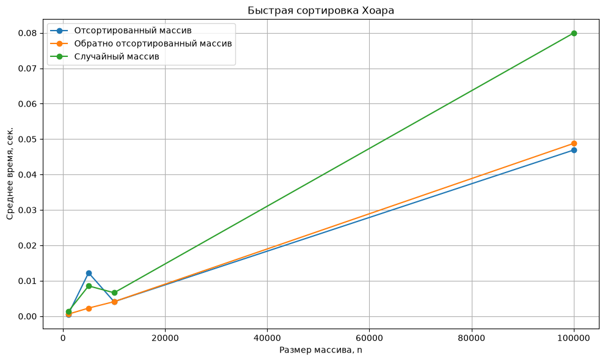
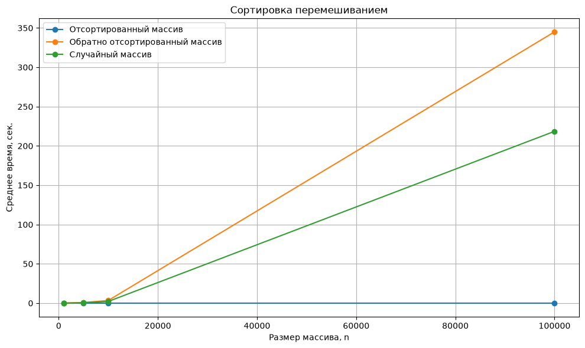

# **ЛР №2: Алгоритмы сортировки**

---
Работу выполнял Гришин Илья ИУ10-36

## **Цель работы**

Изучить основные алгоритмы сортировки, их принципы работы и классификацию, а также приобрести практические навыки реализации и анализа алгоритмов сортировки. Исследовать эффективность выбранных алгоритмов при обработке массивов различного размера и типа.

## **Формулировка задачи**

Реализовать два заданных алгоритма сортировки. Для каждого алгоритма подготовить теоретическое описание, псевдокод и блок-схему, после чего проверить корректность реализации на различных массивах. Провести сравнительное исследование алгоритмов для массивов заданных размеров, отсортированных по возрастанию, по убыванию и в случайном порядке. На основе полученных результатов оценить эффективность алгоритмов и представить её в виде диаграмм.

## **Теоретические сведения**

### **Классификация алгоритмов сортировки**

#### **Основные сведения**

1. **Быстрая сортировка (алгоритм Хоара, Quick Sort)**
2. **Сортировка перемешиванием (Cocktail Shaker Sort)**

| Характеристика | Быстрая сортировка (Хоара) | Сортировка перемешиванием |
|---|---|---|
| Тип | Внутренняя | Внутренняя |
| Принцип работы | Разбиение массива относительно опорного элемента | Последовательный обмен соседних элементов в прямом и обратном направлениях |
| Метод | Обменный | Обменный |
| Сортировка на месте | Да | Да |
| Устойчивость | Нет | Да |
| Адаптивность | Нет | Да |
| Рекурсивность | Да | Нет |
| Дополнительная память | Стек рекурсии | Не требуется |

#### **Сложность алгоритмов**

| Алгоритм | Лучший случай | Средний случай | Худший случай | Дополнительная память |
|---|---:|---:|---:|---:|
| Быстрая сортировка (Хоара) | `O(n log n)` | `O(n log n)` | `O(n²)` | `O(log n)` в среднем, `O(n)` в худшем случае |
| Сортировка перемешиванием | `O(n)` | `O(n²)` | `O(n²)` | `O(1)` |

### **Теоретическое описание алгоритмов сортировки**

#### 1. Быстрая сортировка (алгоритм Хоара)

Быстрая сортировка — алгоритм сортировки, основанный на принципе **«разделяй и властвуй»**. На каждом этапе из массива выбирается опорный элемент, относительно которого выполняется разделение массива на две части: элементы, меньшие опорного, и элементы, большие опорного.

После разделения полученные части массива рекурсивно сортируются аналогичным способом. Процесс продолжается до тех пор, пока размер рассматриваемой части массива не станет равен одному элементу или нулю.

Основные этапы алгоритма:

1. Выбрать опорный элемент.
2. Разделить массив относительно опорного элемента.
3. Рекурсивно отсортировать левую часть массива.
4. Рекурсивно отсортировать правую часть массива.
5. Завершить работу после сортировки всех частей массива.

Эффективность быстрой сортировки зависит от выбора опорного элемента и качества разбиения массива. При достаточно равномерном разделении временная сложность составляет `O(n log n)`. В худшем случае, когда разбиение оказывается крайне неравномерным, сложность может достигать `O(n²)`.

#### 2. Сортировка перемешиванием

Сортировка перемешиванием — алгоритм обменной сортировки, являющийся двунаправленной разновидностью пузырьковой сортировки. В отличие от обычной пузырьковой сортировки, просмотр массива выполняется в обоих направлениях.

Сначала выполняется проход **слева направо**. Соседние элементы сравниваются между собой и при необходимости меняются местами. В результате наибольший элемент перемещается в конец рассматриваемой части массива.

Затем выполняется проход **справа налево**. В результате наименьший элемент перемещается в начало рассматриваемой части массива.

Прямой и обратный проходы чередуются до тех пор, пока массив не будет полностью отсортирован.

Основные этапы алгоритма:

1. Выполнить проход по массиву слева направо.
2. Сравнивать соседние элементы.
3. При необходимости менять элементы местами.
4. Уменьшить правую границу рассматриваемой области.
5. Выполнить проход справа налево.
6. Сравнивать соседние элементы и выполнять необходимые обмены.
7. Уменьшить левую границу рассматриваемой области.
8. Повторять проходы до полной сортировки массива.

Алгоритм позволяет досрочно завершить работу, если во время очередного прохода не было выполнено ни одного обмена. Поэтому для уже отсортированного массива лучший случай имеет сложность `O(n)`. В среднем и в худшем случаях временная сложность составляет `O(n²)`. Сортировка выполняется непосредственно в исходном массиве и требует `O(1)` дополнительной памяти.

## **Разработка алгоритмов**


#### _Алгоритм Хоара(quick sort)_





```python
АЛГОРИТМ QuickSort(A, left, right)

    ЕСЛИ left >= right ТО
        ВОЗВРАТ
    КОНЕЦ ЕСЛИ

    i ← left
    j ← right
    pivot ← A[(left + right) / 2]

    ПОКА i <= j

        ПОКА A[i] < pivot
            i ← i + 1
        КОНЕЦ ПОКА

        ПОКА A[j] > pivot
            j ← j - 1
        КОНЕЦ ПОКА

        ЕСЛИ i <= j ТО
            обменять A[i] и A[j]
            i ← i + 1
            j ← j - 1
        КОНЕЦ ЕСЛИ

    КОНЕЦ ПОКА

    ЕСЛИ left < j ТО
        QuickSort(A, left, j)
    КОНЕЦ ЕСЛИ

    ЕСЛИ i < right ТО
        QuickSort(A, i, right)
    КОНЕЦ ЕСЛИ

КОНЕЦ АЛГОРИТМА

вызов:
QuickSort(A, 0, n - 1)
```

#### _Cocktail shaker sort_




```python
АЛГОРИТМ CocktailSort(A, n)

    left ← 0
    right ← n - 1
    swapped ← ИСТИНА

    ПОКА swapped = ИСТИНА

        swapped ← ЛОЖЬ

        // Проход слева направо
        ДЛЯ i от left до right - 1

            ЕСЛИ A[i] > A[i + 1] ТО
                обменять A[i] и A[i + 1]
                swapped ← ИСТИНА
            КОНЕЦ ЕСЛИ

        КОНЕЦ ДЛЯ

        ЕСЛИ swapped = ЛОЖЬ ТО
            ВЫХОД ИЗ ЦИКЛА
        КОНЕЦ ЕСЛИ

        right ← right - 1
        swapped ← ЛОЖЬ

        // Проход справа налево
        ДЛЯ i от right до left + 1 с шагом -1

            ЕСЛИ A[i - 1] > A[i] ТО
                обменять A[i - 1] и A[i]
                swapped ← ИСТИНА
            КОНЕЦ ЕСЛИ

        КОНЕЦ ДЛЯ

        left ← left + 1

    КОНЕЦ ПОКА

КОНЕЦ АЛГОРИТМА
```

## **Реализация алгоритмов**


```python
def quick_sort(lst, left, right):

    if left >= right:
        return lst

    i = left
    j = right
    pivot = lst[(left + right) // 2]

    while i <= j:

        while lst[i] < pivot:
            i += 1

        while lst[j] > pivot:
            j -= 1

        if i <= j:
            lst[i], lst[j] = lst[j], lst[i]
            i += 1
            j -= 1

    if left < j:
        quick_sort(lst, left, j)

    if i < right:
        quick_sort(lst, i, right)

    return lst
```


```python
def cocktail_sort(lst):
    left = 0
    right = len(lst) - 1
    swapped = True

    while swapped:

        swapped = False

        for i in range(left, right):
            if lst[i] > lst[i + 1]:
                lst[i], lst[i + 1] = lst[i + 1], lst[i]
                swapped = True

        if not swapped:
            break

        right -= 1
        swapped = False

        for i in range(right, left, -1):
            if lst[i - 1] > lst[i]:
                lst[i - 1], lst[i] = lst[i], lst[i - 1]
                swapped = True

        left += 1

    return lst
```


```python
def test_sorting_algorithms():
    test_arrays = [
        [],
        [1],
        [1, 2, 3, 4, 5],
        [5, 4, 3, 2, 1],
        [3, 1, 4, 1, 5, 9, 2, 6],
        [5, 5, 3, 3, 1, 1],
        [-3, 5, -1, 0, 2, -7],
    ]

    for test_array in test_arrays:

        quick_array = test_array.copy()

        if len(quick_array) > 0:
            quick_sort(quick_array, 0, len(quick_array) - 1)

        assert quick_array == sorted(test_array), \
            f"Ошибка Quick Sort: {test_array}"

        cocktail_array = test_array.copy()
        cocktail_sort(cocktail_array)

        assert cocktail_array == sorted(test_array), \
            f"Ошибка Cocktail Sort: {test_array}"

    print("Все тесты пройдены успешно!")


test_sorting_algorithms()
```

## **Ручная троссировка алгоритмов**

```text
A = [5, 2, 4, 1, 3]
```

### Ручная трассировка быстрой сортировки Хоара

В реализации в качестве опорного элемента выбирается средний элемент текущего участка массива:

```text
pivot = A[(left + right) // 2]
```

| Шаг | `left` | `right` | `pivot` | `i` | `j` | Действие | Массив |
|---:|---:|---:|---:|---:|---:|---|---|
| 1 | 0 | 4 | 4 | 0 | 4 | Обмен `A[0]` и `A[4]` | `[3, 2, 4, 1, 5]` |
| 2 | 0 | 4 | 4 | 1 | 3 | Обмен `A[1]` и `A[3]` | `[3, 1, 4, 2, 5]` |
| 3 | 0 | 4 | 4 | 2 | 2 | Обмен `A[2]` и `A[2]` | `[3, 1, 4, 2, 5]` |
| 4 | 0 | 4 | 4 | 3 | 1 | Разбиение завершено | `[3, 1, 4, 2, 5]` |
| 5 | 0 | 1 | 1 | 0 | 1 | Обмен `A[0]` и `A[1]` | `[1, 3, 4, 2, 5]` |
| 6 | 0 | 1 | 1 | 1 | 0 | Разбиение завершено | `[1, 3, 4, 2, 5]` |
| 7 | 2 | 4 | 2 | 2 | 4 | Обмен `A[2]` и `A[3]` | `[1, 3, 2, 4, 5]` |
| 8 | 2 | 4 | 2 | 3 | 3 | Разбиение завершено | `[1, 3, 2, 4, 5]` |
| 9 | 2 | 2 | 2 | 2 | 2 | Участок содержит один элемент | `[1, 3, 2, 4, 5]` |
| 10 | 3 | 4 | 4 | 3 | 4 | Обмен не требуется | `[1, 3, 2, 4, 5]` |

После выполнения всех рекурсивных вызовов массив принимает вид:

```text
[1, 2, 3, 4, 5]
```

Таким образом, алгоритм корректно разбивает исходный массив относительно опорных элементов и сортирует полученные части.

### Ручная трассировка сортировки перемешиванием

Исходный массив:

```text
A = [5, 2, 4, 1, 3]
```

#### Проход слева направо

| Шаг | Сравнение | Действие | Массив |
|---:|---|---|---|
| 1 | `5 > 2` | Обмен | `[2, 5, 4, 1, 3]` |
| 2 | `5 > 4` | Обмен | `[2, 4, 5, 1, 3]` |
| 3 | `5 > 1` | Обмен | `[2, 4, 1, 5, 3]` |
| 4 | `5 > 3` | Обмен | `[2, 4, 1, 3, 5]` |

После первого прохода максимальный элемент `5` перемещается в конец массива.

#### Проход справа налево

| Шаг | Сравнение | Действие | Массив |
|---:|---|---|---|
| 5 | `3 > 1` | Обмен | `[2, 4, 1, 3, 5]` |
| 6 | `4 > 1` | Обмен | `[2, 1, 4, 3, 5]` |
| 7 | `2 > 1` | Обмен | `[1, 2, 4, 3, 5]` |

После обратного прохода минимальный элемент `1` перемещается в начало массива.

#### Повторный проход слева направо

| Шаг | Сравнение | Действие | Массив |
|---:|---|---|---|
| 8 | `1 < 2` | Обмен не требуется | `[1, 2, 4, 3, 5]` |
| 9 | `2 < 4` | Обмен не требуется | `[1, 2, 4, 3, 5]` |
| 10 | `4 > 3` | Обмен | `[1, 2, 3, 4, 5]` |

После следующего обратного прохода обмены уже не требуются, поэтому алгоритм завершает работу.

Итоговый массив:

```text
[1, 2, 3, 4, 5]
```

### Вывод по ручной трассировке

В результате ручной трассировки оба алгоритма корректно отсортировали исходный массив:

```text
[5, 2, 4, 1, 3] → [1, 2, 3, 4, 5]
```

Быстрая сортировка Хоара выполняет разбиение массива относительно опорного элемента и рекурсивно сортирует полученные части. Сортировка перемешиванием выполняет чередующиеся проходы слева направо и справа налево, перемещая максимальные элементы в конец, а минимальные — в начало.

## **Тестирование**


```python
import random
import time
import matplotlib.pyplot as plt


# Размеры массивов
sizes = [1000, 5000, 10000, 100000]

# Количество повторений
REPEATS = 3


def measure_time(sort_function, array, is_quick_sort=False):
    """
    Измеряет среднее время работы алгоритма.
    Алгоритм запускается REPEATS раз.
    """
    times = []

    for _ in range(REPEATS):
        arr = array.copy()

        start = time.perf_counter()

        if is_quick_sort:
            quick_sort(arr, 0, len(arr) - 1)
        else:
            sort_function(arr)

        end = time.perf_counter()

        times.append(end - start)

    return sum(times) / len(times)


# Результаты
results = {
    "Quick Sort (Хоара)": {
        "sorted": [],
        "reverse": [],
        "random": []
    },
    "Cocktail Sort": {
        "sorted": [],
        "reverse": [],
        "random": []
    }
}


# Проведение эксперимента
for n in sizes:
    print(f"\nРазмер массива: {n}")

    # Исходные массивы
    sorted_array = list(range(n))
    reverse_array = list(range(n, 0, -1))

    random_array = list(range(n))
    random.shuffle(random_array)

    # Quick Sort
    print("  Quick Sort:")

    t = measure_time(
        quick_sort,
        sorted_array,
        is_quick_sort=True
    )
    results["Quick Sort (Хоара)"]["sorted"].append(t)
    print(f"    Отсортированный: {t:.6f} сек.")

    t = measure_time(
        quick_sort,
        reverse_array,
        is_quick_sort=True
    )
    results["Quick Sort (Хоара)"]["reverse"].append(t)
    print(f"    Обратный:        {t:.6f} сек.")

    t = measure_time(
        quick_sort,
        random_array,
        is_quick_sort=True
    )
    results["Quick Sort (Хоара)"]["random"].append(t)
    print(f"    Случайный:       {t:.6f} сек.")

    # Cocktail Sort
    print("  Cocktail Sort:")

    t = measure_time(
        cocktail_sort,
        sorted_array
    )
    results["Cocktail Sort"]["sorted"].append(t)
    print(f"    Отсортированный: {t:.6f} сек.")

    t = measure_time(
        cocktail_sort,
        reverse_array
    )
    results["Cocktail Sort"]["reverse"].append(t)
    print(f"    Обратный:        {t:.6f} сек.")

    t = measure_time(
        cocktail_sort,
        random_array
    )
    results["Cocktail Sort"]["random"].append(t)
    print(f"    Случайный:       {t:.6f} сек.")


# ---------------------------------------------------------
# Вывод результатов в виде таблицы
# ---------------------------------------------------------

print("\n" + "=" * 90)
print("РЕЗУЛЬТАТЫ ИЗМЕРЕНИЙ")
print("=" * 90)

print(
    f"{'Алгоритм':<25}"
    f"{'Тип массива':<20}"
    f"{'1000':>12}"
    f"{'5000':>12}"
    f"{'10000':>12}"
    f"{'100000':>12}"
)

print("-" * 90)

for algorithm in results:
    for array_type in ["sorted", "reverse", "random"]:

        names = {
            "sorted": "Отсортированный",
            "reverse": "Обратный",
            "random": "Случайный"
        }

        values = results[algorithm][array_type]

        print(
            f"{algorithm:<25}"
            f"{names[array_type]:<20}"
            f"{values[0]:>12.6f}"
            f"{values[1]:>12.6f}"
            f"{values[2]:>12.6f}"
            f"{values[3]:>12.6f}"
        )


# ---------------------------------------------------------
# ГРАФИК 1 — Quick Sort
# ---------------------------------------------------------

plt.figure(figsize=(10, 6))

plt.plot(
    sizes,
    results["Quick Sort (Хоара)"]["sorted"],
    marker="o",
    label="Отсортированный массив"
)

plt.plot(
    sizes,
    results["Quick Sort (Хоара)"]["reverse"],
    marker="o",
    label="Обратно отсортированный массив"
)

plt.plot(
    sizes,
    results["Quick Sort (Хоара)"]["random"],
    marker="o",
    label="Случайный массив"
)

plt.xlabel("Размер массива, n")
plt.ylabel("Среднее время, сек.")
plt.title("Быстрая сортировка Хоара")
plt.grid(True)
plt.legend()
plt.tight_layout()
plt.show()


# ---------------------------------------------------------
# ГРАФИК 2 — Cocktail Sort
# ---------------------------------------------------------

plt.figure(figsize=(10, 6))

plt.plot(
    sizes,
    results["Cocktail Sort"]["sorted"],
    marker="o",
    label="Отсортированный массив"
)

plt.plot(
    sizes,
    results["Cocktail Sort"]["reverse"],
    marker="o",
    label="Обратно отсортированный массив"
)

plt.plot(
    sizes,
    results["Cocktail Sort"]["random"],
    marker="o",
    label="Случайный массив"
)

plt.xlabel("Размер массива, n")
plt.ylabel("Среднее время, сек.")
plt.title("Сортировка перемешиванием")
plt.grid(True)
plt.legend()
plt.tight_layout()
plt.show()
```

    
    Размер массива: 1000
      Quick Sort:
        Отсортированный: 0.000482 сек.
        Обратный:        0.000566 сек.
        Случайный:       0.001266 сек.
      Cocktail Sort:
        Отсортированный: 0.000048 сек.
        Обратный:        0.042886 сек.
        Случайный:       0.044843 сек.
    
    Размер массива: 5000
      Quick Sort:
        Отсортированный: 0.012250 сек.
        Обратный:        0.002282 сек.
        Случайный:       0.008543 сек.
      Cocktail Sort:
        Отсортированный: 0.000534 сек.
        Обратный:        0.814164 сек.
        Случайный:       0.536230 сек.
    
    Размер массива: 10000
      Quick Sort:
        Отсортированный: 0.004087 сек.
        Обратный:        0.004097 сек.
        Случайный:       0.006615 сек.
      Cocktail Sort:
        Отсортированный: 0.000281 сек.
        Обратный:        3.399000 сек.
        Случайный:       2.156758 сек.
    
    Размер массива: 100000
      Quick Sort:
        Отсортированный: 0.046897 сек.
        Обратный:        0.048773 сек.
        Случайный:       0.079937 сек.
      Cocktail Sort:
        Отсортированный: 0.003093 сек.
        Обратный:        345.072728 сек.
        Случайный:       218.552996 сек.
    
    ==========================================================================================
    РЕЗУЛЬТАТЫ ИЗМЕРЕНИЙ
    ==========================================================================================
    Алгоритм                 Тип массива                 1000        5000       10000      100000
    ------------------------------------------------------------------------------------------
    Quick Sort (Хоара)       Отсортированный         0.000482    0.012250    0.004087    0.046897
    Quick Sort (Хоара)       Обратный                0.000566    0.002282    0.004097    0.048773
    Quick Sort (Хоара)       Случайный               0.001266    0.008543    0.006615    0.079937
    Cocktail Sort            Отсортированный         0.000048    0.000534    0.000281    0.003093
    Cocktail Sort            Обратный                0.042886    0.814164    3.399000  345.072728
    Cocktail Sort            Случайный               0.044843    0.536230    2.156758  218.552996


    

    


    

    


## **Вывод**

В ходе лабораторной работы были изучены и реализованы два алгоритма сортировки: быстрая сортировка Хоара и сортировка перемешиванием. Для алгоритмов были разработаны псевдокоды, блок-схемы и программы на Python.

Корректность реализаций проверена на массивах различного типа, все тесты пройдены успешно. Также была выполнена ручная трассировка и проведено сравнение времени работы на массивах размером `1000`, `5000`, `10000` и `100000` элементов.

В результате установлено, что **Quick Sort эффективнее Cocktail Sort на больших массивах** благодаря средней сложности `O(n log n)`. Сортировка перемешиванием имеет сложность `O(n²)`, но хорошо работает на уже отсортированных данных. Полученные результаты представлены в таблицах и графиках.
